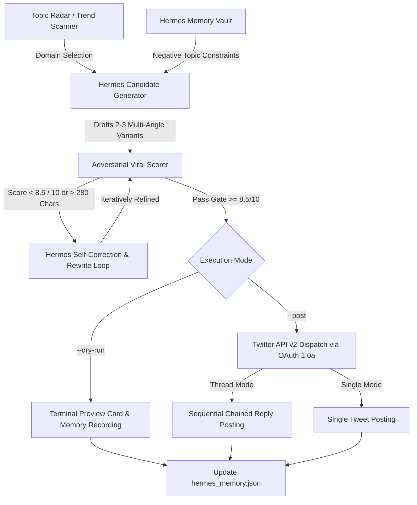

# 🚀 Hermes AutoBot Pro: Autonomous Social Media Intelligence Engine

**Hermes AutoBot** transforms standard automated posting into a **multi-stage autonomous agent pipeline** powered by:
- **NousResearch Hermes Agent Architecture** (`SOUL.md`, multi-turn reflection, and adversarial critique)
- **Local FreeLLMAPI** (`http://127.0.0.1:31415/v1`) using **836M+ free monthly tokens** across 330+ AI models
- **Twitter / X API v2** (RFC 5849 OAuth 1.0a authentication with threaded reply chaining)
- **Persistent Hermes Memory Vault** (`hermes_memory.json`) preventing repetitive content and tracking viral analytics

---

## 🧠 1. Architectural Overview



---

## ⚡ 2. Key Capabilities & Upgrades

| Feature | Legacy AutoBot | 🌟 Hermes AutoBot v3.0 |
| :--- | :--- | :--- |
| **Cognitive Engine** | Basic single-shot prompt | **NousResearch Hermes Agentic Loop** (Direct, high-signal, self-critiquing) |
| **Token Cost** | Paid Gemini API limits | **FreeLLMAPI Local Server** (836M+ Free Tokens, \$0 cost) |
| **Model Redundancy** | Single model point of failure | **Auto-Routing Fallback** (`qwen3.8-27b`, `glm-4.7-flash`, `deepseek-r1-distill`, `gemini-3.7-flash`) |
| **Quality Control** | Posts whatever LLM outputs | **Strict Algorithmic Gate**: Evaluates Hook Power, Insight Density, and Character Count ($\le 280$) |
| **Self-Refinement** | None | **Iterative Rewrite Loop**: Rejects and rewrites drafts scoring $< 8.5 / 10$ |
| **Format Handling** | Single standalone tweets | **Thread Mode**: Generates & posts connected 3-part micro-threads via reply chaining |
| **Memory & Anti-Spam**| Stateless (repeats topics) | **Persistent Knowledge Vault**: Tracks hashes & recent topics to ensure zero duplicate content |

---

## 🛠️ 3. Quick Start: Desktop Launchers

For zero-command-line execution, three dedicated launchers have been placed on your Desktop:

1. **`Test_Hermes_AutoBot_DryRun.bat`**:
   - Double-click to instantly run a complete dry-run cycle.
   - Shows live Hermes reasoning, critique passes, viral scores, and the final winning tweet preview.
2. **`Run_Hermes_AutoBot.bat`**:
   - Master interactive menu allowing you to:
     - Run Dry-Run Preview (Single or Thread)
     - Post Live to Twitter / X (Single or Thread)
     - Enter custom topics
     - Launch continuous background daemon
     - View Knowledge Vault statistics
     - Edit Twitter credentials
3. **`PhoneStorageManager.exe`**:
   - S24 Ultra storage manager & duplicate cleaner tool created previously.

---

## 💻 4. Command Line Usage

From `C:\Users\acer\Documents\GitHub\twitter-auto-poster-bot-ai\`:

```powershell
# 1. Test single tweet generation (Safe dry-run preview)
python hermes_autobot.py --dry-run

# 2. Test 3-tweet thread generation
python hermes_autobot.py --thread --dry-run

# 3. Post a single tweet live to Twitter / X
python hermes_autobot.py --post

# 4. Post a 3-tweet thread live to Twitter / X
python hermes_autobot.py --thread --post

# 5. Provide a custom topic or news event
python hermes_autobot.py --topic "India's UPI crossing global milestones" --dry-run

# 6. Run an autonomous continuous daemon (auto-post every 60 minutes)
python hermes_autobot.py --continuous --interval 60 --post

# 7. Check Hermes memory stats & performance history
python hermes_autobot.py --stats
```

---

## 🔑 5. Twitter / X API Credentials

Your credentials are loaded securely from `secrets.json` located in `C:\Users\acer\Documents\GitHub\twitter-auto-poster-bot-ai\secrets.json`:

```json
{
  "APP_KEY": "YOUR_TWITTER_CONSUMER_KEY",
  "APP_SECRET": "YOUR_TWITTER_CONSUMER_SECRET",
  "ACCESS_TOKEN": "YOUR_TWITTER_ACCESS_TOKEN",
  "ACCESS_SECRET": "YOUR_TWITTER_ACCESS_SECRET"
}
```

> [!NOTE]
> When testing with `--dry-run`, Twitter credentials are not required. The Hermes engine will fully simulate topic selection, reasoning, candidate creation, critique, and scoring.
